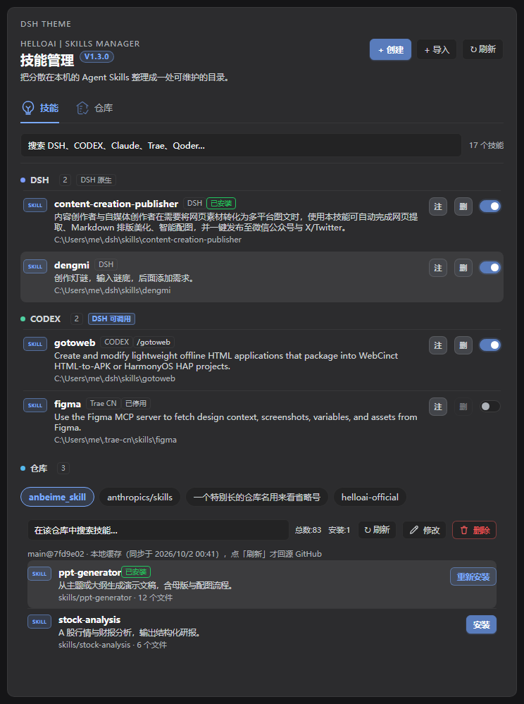
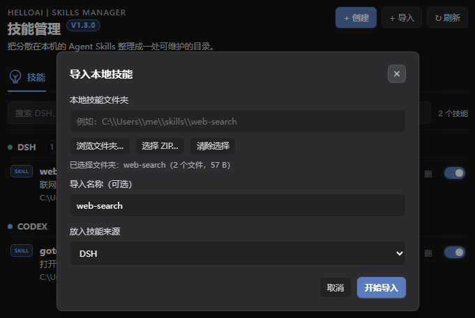
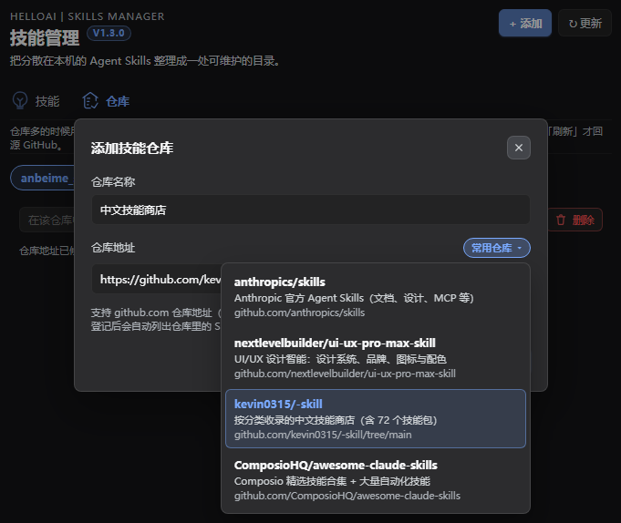

# HelloAI Skills · DeepSeek Harness 技能与仓库管理

[](LICENSE)


**把散落在十几个 AI 工具里的技能，收进一个能管的面板。** 扫描本机所有 Agent 的技能目录，列出、搜索、备注、启停、删除；把列表里的**每一个**技能都注册成 DSH 可调用技能，在对话里直接 `/名称` 调用；还能登记 GitHub 仓库，从仓库里直接挑技能安装。



*设置 → 技能管理：按来源分组（DSH / CODEX / Claude / Trae…），每条都能注、删、启停；下方是登记过的仓库。*

## 它能做什么

- **一处看全**：自动扫描 DSH、CODEX、Claude、Gemini、OpenCode、Cursor、Copilot、Windsurf、Trae、Qoder、OpenClaw、Roo、CodeBuddy 等工具的技能目录，家目录下任何 `<工具>/skills` 也会被自动发现。
- **变成 DSH 技能**：不只是在面板里列出来——每个技能都会被注册进 DSH，对话里 `/gotoweb`、`/dengmi` 这样直接调用，模型目录里也能看到。
- **不依赖宿主加载器**：DSH 自带的 `skill-filesystem` 在某些 profile 里是停用的（`$DSH_HOME/skills` 于是谁都读不到）。本插件自己注册这些目录，不靠它。
- **仓库 → 技能 → 安装**：登记一个 GitHub 仓库，卡片里直接列出里面的技能，点「安装」就落到 `$DSH_HOME/skills/`。
- **省配额**：列表**默认读本地缓存**，只有点「刷新」才回源 GitHub，用的是不消耗 API 配额的 `tree-list` + `raw` 路径。断网时旧清单照样能看能装。
- **三种导入方式**：填路径（由 DSH 进程直接读盘）/ 浏览文件夹（适合 DSH 跑在别的机器或容器里）/ 选 ZIP（宿主自己解压，支持 GBK 文件名）。
- **搜索、备注、启停、删除**：外部目录的技能只能停用，不会被删；只有 DSH 自己的技能目录支持删除。

<details>
<summary>点击看「导入本地技能」和「常用仓库」界面</summary>




</details>

## 安装

```bash
dsh plugin --profile desktop add github:hello-heyongping/dsh-helloai-skills
```

或者 clone 到本地再装（想改代码就用这个）：

```bash
git clone https://github.com/hello-heyongping/dsh-helloai-skills.git
cd dsh-helloai-skills
dsh plugin --profile desktop add .
```

> 把 `desktop` 换成你自己的 profile 名。仓库里**已经带上构建好的 `lib/`**，不需要先 `npm install`。

装完在 **设置** 侧栏会出现「技能管理」。数据存在 `$DSH_HOME/helloai-skills/`，接口前缀 `/api/dsh-helloai-skills`。

## 快速上手

1. 打开 **设置 → 技能管理**，插件已经在扫描了；
2. 「技能」标签页里按来源分组，右上角搜索框可以全局搜技能名和说明；
3. 想从网上加技能 → 切到「仓库」标签页 → **添加仓库** → 填 `https://github.com/owner/repo`；
4. 「常用仓库」菜单里预置了几个常见技能库（Anthropic 官方技能库、中文技能商店等），点一下自动填表；
5. 在仓库卡片里点 **安装** → 技能落到 `$DSH_HOME/skills/`，回到对话框就能 `/名称` 调用。

**私有仓库 / 想提高 API 配额？** 设置环境变量 `DSH_HELLOAI_GITHUB_TOKEN`（或 `GITHUB_TOKEN` / `GH_TOKEN`），只有 github.com 和 githubusercontent.com 的请求会带上它。

## 常见问题

**面板里能看到技能，但对话里 `/名称` 出不来？**
技能名会被统一转成 kebab-case（`TRAE-computer-use` → `/trae-computer-use`），这样才能通过 DSH 的技能名校验。按转好的名字试。

**同一个技能在好几个目录里都有？**
按来源优先级去重：DSH > 公共 Agent > CODEX > Claude > … > Qoder > 自动发现。

**改了代码但界面没变？**
客户端产物每次请求现读磁盘，`npm run build` 后**刷新页面**即可。Host 侧改动需要重启 DSH。`$DSH_HOME/helloai-skills/apply.log` 每次启动会追加一行，用来确认"跑起来的到底是哪份代码"。

---

> 下面是完整的实现说明，写给想改代码、或想搞清"为什么这么设计"的人。


- 在「设置」侧栏新增「技能管理」页面（`settings.section` 槽位）
- 扫描本机各 Agent 的技能目录，把列表里的**每一个**技能都注册成 **DSH 可调用技能**
  （对话里 `/gotoweb`、`/dengmi` 这样直接调用，模型目录里也能看到）
- 技能与仓库分栏展示；仓库添加后直接列出内部技能，逐条「安装」到 DSH
- 全局技能搜索、备注、详情、删除和启停
- 数据保存在 `$DSH_HOME/helloai-skills/`
- 接口前缀：`/api/dsh-helloai-skills`

## 技能来源

| 来源 | 目录 | DSH 可调用 |
| --- | --- | --- |
| DSH | `$DSH_HOME/skills` | 是（宿主加载器不注册该目录时由本插件注册） |
| 公共 Agent | `$DSH_AGENTS_HOME` 或 `~/.agents/skills` | 是 |
| CODEX | `~/.codex/skills` | 是 |
| Claude / Gemini / OpenCode / Cursor / Copilot / Windsurf | `~/.claude/skills`、`~/.gemini/skills`、`~/.config/opencode/skills`、`~/.cursor/skills`、`~/.copilot/skills`、`~/.codeium/windsurf/skills` | 是 |
| Trae / Trae CN | `~/.trae/skills`、`~/.trae-cn/skills` | 是 |
| Qoder | `~/.qoder/skills`，以及 `~/.qoder/plugins/cache/*/*/skills` | 是 |
| OpenClaw / Roo / CodeBuddy / CC Switch | `~/.openclaw/skills`、`~/.clawdbot/skills`、`~/.roo/skills`、`~/.codebuddy/skills`、`~/.cc-switch/skills` | 是 |
| 自动发现 | 家目录下任何 `<工具>/skills`，且里面确实有技能 | 是 |

> DSH 自带的加载器是 `@deepseek-ai/dsh-skill-filesystem`。它在某些 profile（例如桌面 profile）里是**停用**的，
> 这时 `$DSH_HOME/skills` 里的技能谁也读不到；本插件现在会自己注册这些目录，不再依赖宿主加载器是否开启。
> 想恢复宿主自己加载，也可以在插件管理里把 `skill-filesystem` 打开，两者同时开启不会冲突（按 rank 去重）。

各来源都可以用环境变量覆盖（`DSH_CODEX_HOME`、`DSH_TRAE_CN_HOME`、`DSH_QODER_HOME`……）。

- 技能名统一转成 kebab-case（`TRAE-computer-use` → `/trae-computer-use`），
  这样才通过 DSH 的技能名校验。
- 同名技能按来源优先级去重：DSH > 公共 Agent > CODEX > Claude > … > Qoder > 自动发现。
- 列表里的**每个**技能都会注册给 DSH（`$DSH_HOME/skills` 也一样），所以都能用 `/名称` 调用；
  如果宿主自己的加载器也注册了同一个目录，注册表按 rank 自行裁决，重复注册不会出错。
- 外部目录里的技能只能停用（开关），不会被删除；只有 DSH 技能目录支持删除。
- 开关、备注、安装、删除后都会让 DSH 的技能目录立即刷新（provider 失效 + `commands/change`）。

## 导入本地技能

「技能」标签页的「导入」弹窗有三种填法，装的是同一个东西：

| 方式 | 说明 |
| --- | --- |
| 直接填路径 | 例如 `C:\Users\me\skills\web-search`，由 DSH 进程**直接读盘**，不经过浏览器 |
| **浏览文件夹…** | 调系统目录选择器，选中的整个文件夹上传给 DSH 再落盘（适合 DSH 跑在另一台机器 / 容器里） |
| **选择 ZIP…** | 选一个 `.zip`，宿主自己解压后安装（ZIP64 除外；文件名按 UTF-8，未标 UTF-8 时按 GBK 解码） |

- 三种方式都只认 `SKILL.md`：ZIP 里可以直接是技能目录，也可以是「装着技能目录的压缩包」；
  按**最浅那一层** `SKILL.md` 定位技能根，同一层出现多个技能会明确拒绝（一次只导入一个）。
- 导入名称留空时取文件夹（或 ZIP 内技能目录）的名字，必须是英文、数字、点、下划线、短横线。
- 同名技能不会被覆盖：先删掉旧的，或换个名字。
- 落盘走同卷暂存目录 + rename，中途失败不会留下半个技能；成功后写入
  `.helloai-import.json` 记录来源与导入时间。
- 上限：浏览器上传 24MB / 宿主接收 48MB；单文件 12MB、单技能总计 64MB、压缩包内最多 5000 个成员。
  超限会直接报错，不会静默截断。

## 仓库 → 技能 → 安装

「仓库」标签页里登记一个 GitHub 仓库地址后，卡片里**直接**列出仓库中的技能。**列表默认读本地，
只有「刷新」才回源 GitHub**，所以不会触发防刷/配额，网络不稳或断网时旧清单照样能看能装：

1. **添加仓库**时同步一次：读取文件清单（`https://github.com/<owner>/<repo>/tree-list/<commit>`，
   与 GitHub 自己的文件查找器同源，不占用 API 配额；失败时依次回退到 GitHub API、
   jsDelivr），把每个含 `SKILL.md` 的目录识别成一个技能，并把清单落盘到
   `$DSH_HOME/helloai-skills/cache/catalog-<仓库 id>.json`。**响应只等文件清单**（约 2 秒）；
   技能说明由后台按 `ref@commit` 逐条抓取、边抓边写回缓存（只读 raw，不占 API 配额），
   前端在没补完时每 3 秒静默刷新一次，列表可以先看先用。
2. **平时打开页面只读这份缓存**（命中缓存时一次网络请求都不发，卡片上会标注「本地缓存（同步于 …）」），
   仓库列表本身也把技能数与同步时间记在 `repositories.json` 里，不打开卡片就能看到。
3. **点「刷新」才回源**：重新解析 ref、重取文件清单并覆盖缓存；失败会保留旧缓存并在卡片上提示错误。
4. `SKILL.md` 的 frontmatter 提供说明文字（`description`，支持 `>` / `|` 块标量）。
5. 「安装」会把该目录下的所有文件下载到 `$DSH_HOME/skills/<名称>/`，并写入
   `.helloai-source.json` 记录来源仓库、ref 与 commit；「重新安装」覆盖同名目录。
6. 安装/删除后「技能」标签页与对话里的技能目录都会立即出现或消失对应的技能。

支持的地址写法：`https://github.com/owner/repo`、`https://github.com/owner/repo/tree/<分支>`、
`https://github.com/owner/repo/tree/<分支>/<子目录>`（只列出该子目录下的技能）。

### 常用仓库快捷填入

「添加技能仓库 / 修改仓库」弹窗里，「仓库地址」标签右侧有一个**常用仓库**菜单：点一下弹出列表，
选中就把仓库地址填进表单（「仓库名称」当时为空的话，顺手补一个建议名；已经填过的不覆盖）。
列表里就是平时反复手打的那几个仓库：

| 菜单项 | 地址 | 内容 |
| --- | --- | --- |
| Claude 官方技能库 | `https://github.com/anthropics/skills` | Anthropic 官方 Agent Skills（文档、设计、MCP 等） |
| UI/UX Pro Max | `https://github.com/nextlevelbuilder/ui-ux-pro-max-skill` | UI/UX 设计智能：设计系统、品牌、图标与配色 |
| 中文技能商店 | `https://github.com/kevin0315/-skill/tree/main` | 按分类收录的中文技能商店（文档、创作、开发、自动化） |
| Awesome Claude Skills | `https://github.com/ComposioHQ/awesome-claude-skills` | Composio 精选技能合集 + 大量自动化技能 |

列表是客户端里的常量 `REPO_PRESETS`（`src/client.tsx` 顶部）：想增删就往那个数组里改一条，
再重新 `node scripts/build.mjs`；菜单只是「填表」，登记与去重仍走原来的
`/repositories/add`（同一个地址重复添加依旧会被拒绝）。

约束：单个技能最多 400 个文件、单文件 12MB、总计 64MB；同名技能默认不覆盖。
Git 子模块目录（仓库里只存了一个指针）不会被列出。

### 网络与配额

- `tree-list`、`raw.githubusercontent.com`、`cdn.jsdelivr.net` 都不消耗 GitHub API 配额；
  每个请求失败会重试，ref 解析依次尝试仓库页面、`commits.atom`、GitHub API。
- 如需提高 API 回退路径或私有仓库的配额，可设置 `DSH_HELLOAI_GITHUB_TOKEN`
  （或 `GITHUB_TOKEN` / `GH_TOKEN`）环境变量，只有 github.com / githubusercontent.com
  的请求会带上它。

## 配色

关键控件（创建 / 安装 / 打开开关 / 当前标签 / 聚焦描边）统一使用主题里的**高亮色**，
即对话中链接与行内代码用的那支颜色，全部从 `--dsw-*` 令牌取值，所以亮暗主题各自成立、写死的颜色只做兜底。
例外的只有技能名后那个 `/名称` 调用提示：它照旧加框，但字色用正文那一档（`--dsw-alias-label-secondary`），
不高亮——一屏几十个技能时，满排彩色斜杠名会把真正需要点的按钮和开关淹掉。分组标题上的
「DSH 可调用」是分组级说明，仍然用高亮色：

| 用途 | 令牌 | 亮色 | 暗色 |
| --- | --- | --- | --- |
| 高亮前景（文字、描边、图标） | `--dsw-alias-link` | #4176e6 | #7aaaff |
| 实心按钮底色 / 开关开启 | `--dsw-alias-button-info-fill` | #4176e6 | #7aaaff |
| 实心按钮悬停 | `--dsw-alias-button-info-hover` | #7aaaff | #4176e6 |
| 实心按钮上的文字 | `--dsw-alias-label-primary-foreground` | 近白 | 近黑 |
| 淡底 / 描边（徽标、聚焦环） | 由高亮色 `color-mix` 派生 | — | — |

次要但重要的动作（如「重新安装」）用同一支高亮色的描边样式，中性按钮保持次要层级。

## 自测

```bash
node scripts/build.mjs             # 构建 lib/index.js 与 lib/client.js
node scripts/selftest.mjs          # 离线：重复 apply、删除保护、技能提供者契约
node scripts/selftest-client.mjs   # 无浏览器：装载 client bundle、校验注册与导出
node scripts/selftest-catalog.mjs  # 联网：仓库解析、缓存、安装、重复安装拒绝
node scripts/preview-panel.mjs     # 配色自查：渲染明/暗两套面板 PNG（需本机 Chrome/Chromium）
```

## 开发提示

- 客户端半边（`lib/client.js`）必须导出 `inject = ["slots"]`：客户端 Loader 只给声明过的插件注入服务，
  缺少这行时 `apply` 里的 `ctx.slots` 不可用，注册会被静默吞掉，表现为「插件已启动但设置里没有入口」。
- 主机半边（`lib/index.js`）在 DSH 主进程里 import 一次后常驻，改完代码需要重载插件才生效：
  在插件市场里点「立即重启」，或重启 DSH 后刷新页面。若点过「立即重启」而行为没变化，
  说明宿主仍持有旧模块（ESM 缓存），此时需要**完整重启 DSH**。
- 每次 `apply` 会往 `$DSH_HOME/helloai-skills/apply.log` 追加一行（`<时间>  <BUILD_TAG> …`），
  用来确认「跑起来的到底是哪份代码」：改完代码重载后看着这个文件末尾有没有新标记，
  比看界面更容易判断。`BUILD_TAG` 定义在 `src/index.ts` 顶部。
- 设置页标题「技能管理」的右上角有一个版本角标（例如 `V1.1.1`），它显示的是**客户端**版本，
  构建时由 `scripts/build.mjs` 从 `package.json` 的 `version` 注入 `define`。升级时只改
  `package.json` 再重新构建即可，不需要手改界面代码；`BUILD_TAG` 与它保持同一个版本号，
  这样界面和 `apply.log` 不会互相打架。
